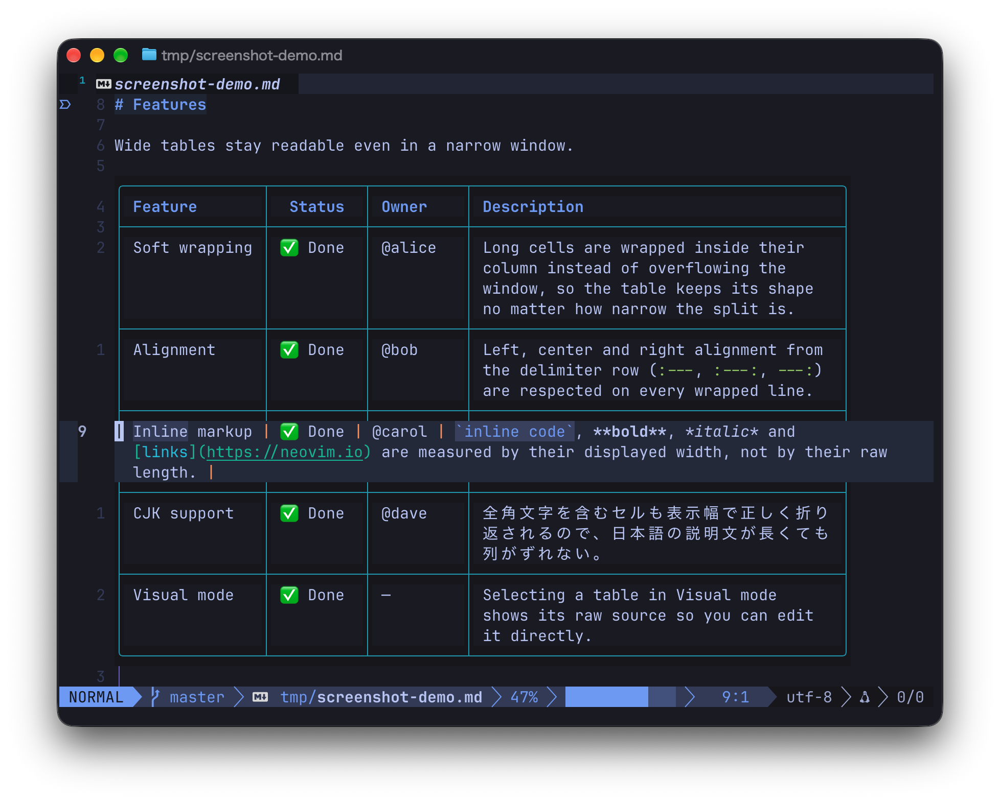

# markdown-table-wrap.nvim

[English](README.md) | 日本語

Markdown のテーブルを、長いセルを列の中で折り返して描画する Neovim プラグインです。

このリポジトリは [ice345/markdown-table-wrap.nvim](https://github.com/ice345/markdown-table-wrap.nvim) の fork です。この fork はすべてのテーブルをその場で描画したまま、カーソルのある行だけを生の Markdown として表示します。カーソルがある行も含めて全てレンダリングされた状態で表示したい場合は、 `MarkdownTableFloatPreview` コマンドでそれ専用のウィンドウを開けます。



Neovim 0.11 以降が必要です。

## 導入

lazy.nvim では次のように書きます。

```lua
return {
  {
    "swnakamura/markdown-table-wrap.nvim",
    ft = { "markdown", "quarto", "rmd" },
    opts = {},
  },
}
```

`render-markdown.nvim` も使っている場合は、テーブルの描画をこのプラグインに任せるために、そちらのテーブル描画を無効にしてください。

```lua
-- ~/.config/nvim/lua/plugins/render-markdown.lua
return {
  "MeanderingProgrammer/render-markdown.nvim",
  opts = {
    pipe_table = {
      enabled = false,
    },
  },
}
```

## 使い方

Markdown ファイルを開くと、すべてのテーブルが自動で描画されます。コマンドを使う必要はありません。

- カーソルのある行は生の Markdown で表示されるので、そのまま編集できます。Insert mode でも、ほかの行は描画されたままです。
- Visual mode では、選択範囲が触れているテーブルだけが生の Markdown になり、Visual mode を抜けると描画に戻ります。
- カーソルが行を移っても、テーブルの画面上の高さは変わりません。
- 行番号を表示している場合は、描画した行にも行番号が付きます。
- テーブル内のリンクは、Neovim 標準の `gx` で開けます。
- 引用ブロックや callout の中のテーブルも描画されます。

行の入れ替えや区切り行の変更など、テーブルの構造を大きく変える編集をするときは、`:MarkdownTableToggleInline` で描画を消してから編集すると安全です。

## コマンド

| コマンド | 動作 |
| --- | --- |
| `:MarkdownTableToggleInline` | 描画の表示と非表示を切り替えます。 |
| `:MarkdownTableFloatPreview` | カーソルのあるテーブルをフローティングウィンドウで表示します。ウィンドウは `q` か `<Esc>` で閉じます。 |
| `:MarkdownTableExport[!] [tsv\|csv]` | カーソルのあるテーブルを TSV（既定）か CSV でレジスタにコピーします。`!` を付けるとバッファのすべてのテーブルをコピーします。 |
| `:MarkdownTableNextCell` / `:MarkdownTablePrevCell` | 同じ行の次または前のセルへ移動します。 |
| `:MarkdownTableNextRow` / `:MarkdownTablePrevRow` | 次または前の行の同じ列へ移動します。 |
| `:MarkdownTableRefresh` | 現在のバッファのテーブルを描き直します。 |
| `:MarkdownTableToggleAutoPreview` | 現在のバッファで自動描画の有効と無効を切り替えます。 |
| `:MarkdownTableStatus` | 現在のバッファの自動描画の状態を表示します。 |

このほかに、`:MarkdownTablePreview`、`:MarkdownTableInlinePreview`、`:MarkdownTableTogglePreview`、`:MarkdownTableClosePreview`、`:MarkdownTableEnableAutoPreview`、`:MarkdownTableDisableAutoPreview` があります。それぞれの説明は `:help markdown-table-wrap` にあります。

キーマップは用意していないので、必要なら lazy.nvim の `keys` に追加してください。

```lua
keys = {
  { "<leader>mi", "<cmd>MarkdownTableToggleInline<cr>", desc = "Toggle Markdown table rendering" },
  { "]c", "<cmd>MarkdownTableNextCell<cr>", desc = "Next table cell" },
  { "[c", "<cmd>MarkdownTablePrevCell<cr>", desc = "Previous table cell" },
},
```

`:MarkdownTableExport` は、セルに表示されている文字列を書き出します。たとえば `[GitHub](https://github.com)` は `GitHub` になります。CSV では、表計算ソフトが数式として評価しないように、`=`、`+`、`-`、`@` で始まる値の先頭に `'` を付けます。この処理は負の数にも適用されます。

## 設定

次の値が既定値です。変えたい項目だけを `opts` に書いてください。

```lua
require("markdown-table-wrap").setup({
  max_width_ratio = 0.9,
  min_col_width = 8,
  max_col_width = 50,
  fit_to_window = true,
  border = "rounded",
  use_unicode_border = true,
  table_border = "rounded",
  row_separator = true,
  preview_mode = "inline",
  inline_mode = "replace",
  inline_position = "above",
  dim_source = true,
  auto_preview = true,
  render_all = true,
  auto_preview_in_insert = true,
  clear_on_cursor_leave = true,
  clear_on_insert = false,
  clear_on_visual = true,
  debounce_ms = 80,
  overlay_priority = 10000,
  inline_line_numbers = true,
  inline_stable_height = true,
  quote_icon = "auto",
  highlight_preset = "default",
  theme_dir = nil,
  themes = {},
  extra_filetypes = {},
  highlights = {},
  link = {
    icon = "",
    wiki = { icon = " ", highlight = "MarkdownTableWrapWikiLink", scope_highlight = "MarkdownTableWrapWikiLink" },
    image = " ",
    custom = {
      github = { pattern = "github", icon = " " },
      gitlab = { pattern = "gitlab", icon = "󰮠 " },
      youtube = { pattern = "youtube", icon = " " },
      bilibili = { pattern = "bilibili", icon = "󰟴 " },
      cern = { pattern = "cern.ch", icon = " " },
    },
  },
})
```

| オプション | 意味 |
| --- | --- |
| `max_width_ratio` | テーブルの最大幅を、ウィンドウのテキスト領域（行番号などの列を除いた幅）に対する比率で指定します。 |
| `min_col_width` / `max_col_width` | 列の最小幅と、折り返さずに広げられる最大幅を指定します。 |
| `fit_to_window` | `true` のときは、列が `min_col_width` より狭くなってもテーブル全体をウィンドウに収めます。 |
| `table_border` | テーブルの角の形を `"rounded"` か `"single"` で指定します。 |
| `use_unicode_border` | `false` にすると、罫線を ASCII で描きます。 |
| `row_separator` | 本文の行の間に横線を引きます。 |
| `border` | フローティングウィンドウの枠の形を指定します。 |
| `preview_mode` | `:MarkdownTablePreview` の表示方法を `"inline"` か `"float"` で指定します。 |
| `inline_mode` | `"replace"` はソースの行を描画で置き換えます。`"insert"` はソースの行を残し、描画したテーブルを `inline_position`（`"above"` か `"below"`）の位置に追加します。 |
| `dim_source` | `inline_mode = "insert"` のときに、ソースの行を暗く表示します。 |
| `auto_preview` | Markdown バッファを自動で描画します。 |
| `render_all` | `false` にすると、カーソルのあるテーブルだけを描画します。 |
| `auto_preview_in_insert` / `clear_on_insert` | Insert mode で描画を続けるか、ソースに戻すかを指定します。 |
| `clear_on_visual` | Visual mode で、選択範囲が触れているテーブルを生の Markdown で表示します。 |
| `clear_on_cursor_leave` | カーソルがテーブルやウィンドウを離れたときに描画を消します。 |
| `debounce_ms` | カーソル移動や編集の後、描き直すまでの待ち時間（ミリ秒）を指定します。 |
| `overlay_priority` | 描画に使う extmark の優先度を指定します。 |
| `inline_line_numbers` | 描画した行に行番号を描きます。 |
| `inline_stable_height` | カーソルが行を移ってもテーブルの高さが変わらないように、カーソル行の下に空行を足します。 |
| `quote_icon` | 引用ブロック内のテーブルの前に描く記号を指定します。`"auto"` は `render-markdown.nvim` があればその `▋` を、なければ `>` を描きます。`false` にすると記号を描きません。 |
| `extra_filetypes` | テーブルを描画するファイルタイプを追加します。既定で対象になるのは `markdown`、`md`、`quarto`、`rmd`、`rmarkdown` です。追加したファイルタイプは、lazy.nvim の `ft` にも加えてください。 |
| `highlight_preset` | 配色を `"default"`、`"tokyonight"`、`"catppuccin"`、`"render_markdown"`、`"auto"`、または独自テーマの名前で指定します。 |
| `themes` / `theme_dir` | 独自テーマを設定に直接書くか、`theme_dir` に置いた `<名前>.lua` から読み込みます。 |
| `highlights` | プリセットの色を、項目ごとに上書きします。 |
| `link` | リンク、wiki リンク、画像のアイコンと、URL のパターンごとのアイコンを指定します。 |

`themes` と `highlights` で使える項目は `border`、`inline`、`source`、`header`、`code`、`link`、`wiki_link`、`image`、`bold`、`italic`、`strike`、`mark` です。引用記号の色は `quote` と `callout_info`・`callout_success`・`callout_hint`・`callout_warn`・`callout_error` で指定します。

```lua
require("markdown-table-wrap").setup({
  highlight_preset = "default",
  highlights = {
    border = { fg = "#7aa2f7" },
    code = { fg = "#9ece6a" },
    bold = { fg = "#e0af68", bold = true },
    italic = { fg = "#7aa2f7", italic = true },
    strike = { fg = "#f7768e", strikethrough = true },
    mark = { fg = "#1a1b26", bg = "#e0af68" },
    link = { fg = "#7dcfff", underline = true },
    quote = { fg = "#565f89" },
    callout_success = { fg = "#9ece6a" },
  },
})
```

色をリンクで指定した項目は背景が透明になります。セルの背景を塗りたい場合は、`bg` を明示してください。

## Lua API

```lua
local table_wrap = require("markdown-table-wrap")
table_wrap.get_buffer_config(0) -- バッファで有効な設定のコピーを返します。
table_wrap.get_preview_mode(0) -- "inline" か "float" を返します。
table_wrap.export_table({ format = "csv", all = true }) -- :MarkdownTableExport と同じ処理をします。
```

`export_table` には、`format`（`"tsv"` か `"csv"`）、`all`、`csv_formula_policy = "raw"`（`'` を付けない）、`silent`（通知しない）を渡せます。

## 機能

- 列幅をウィンドウの幅に合わせて割り当て、長いセルを列の中で折り返します。
- 日本語や中国語は文字単位で折り返し、`。` や `」` を行頭に、`「` を行末に置きません。英単語は空白などの区切りでだけ折り返します。
- 全角文字を含むセルも、表示幅で列を揃えます。
- インラインコード、強調、取り消し線、リンク、`==highlight==`、wiki リンク、画像の代替テキストを、記号を除いて表示します。強調は CommonMark の規則に従います。
- インラインコードは、列に収まる限り途中で折り返しません。
- インラインコードの中のパイプやエスケープしたパイプで、セルを区切りません。
- ソースのバッファを書き換えません。描画は extmark だけで行います。
- `'wrap'` と `'concealcursor'` を変更しません。`'conceallevel'` は描画中だけウィンドウローカルに上げ、描画を消すと元に戻します。
- 外部のプログラムを必要としません。

## 開発

テストはリポジトリのルートで次のように実行します。各テストの内容は [tests/README.md](tests/README.md) に、リリースの手順は [PUBLISHING.md](PUBLISHING.md) にあります。

```sh
nvim --headless -u NONE --cmd "set shadafile=NONE" --cmd "set noswapfile" \
  -c "set rtp+=." \
  -c "luafile tests/run.lua" \
  -c "qa!"
```

## ライセンス

MIT
