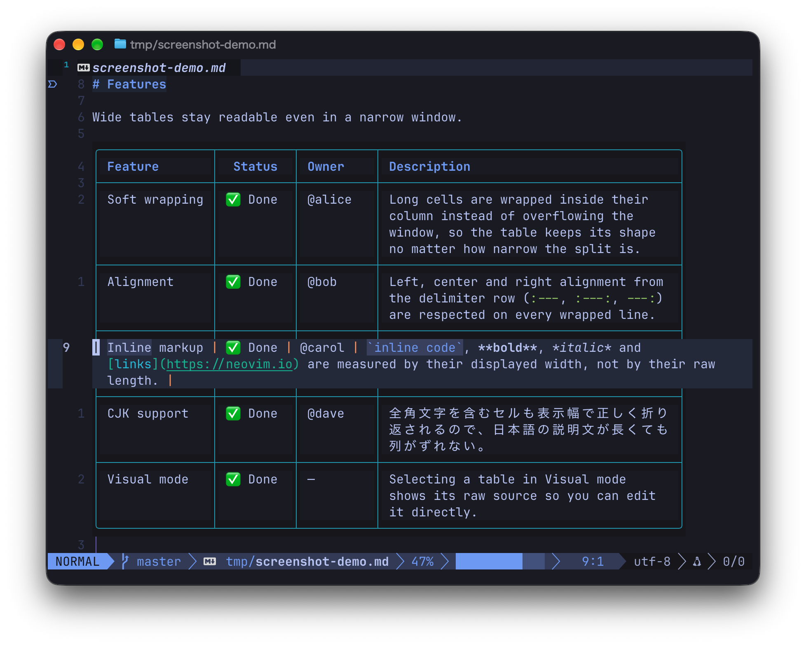

# markdown-table-wrap.nvim

English | [日本語](README.ja.md)

A Neovim plugin that renders Markdown tables with long cells wrapped inside their columns.

This repository is a fork of [ice345/markdown-table-wrap.nvim](https://github.com/ice345/markdown-table-wrap.nvim). This fork keeps every table rendered in place and shows only the row under the cursor as raw Markdown.



Requires Neovim 0.11 or later.

## Installation

With lazy.nvim:

```lua
return {
  {
    "swnakamura/markdown-table-wrap.nvim",
    ft = { "markdown", "quarto", "rmd" },
    opts = {},
  },
}
```

If you also use `render-markdown.nvim`, disable its table rendering so that this plugin handles tables.

```lua
-- ~/.config/nvim/lua/plugins/render-markdown.lua
return {
  "MeanderingProgrammer/render-markdown.nvim",
  opts = {
    pipe_table = {
      enabled = false,
    },
  },
}
```

## Usage

Open a Markdown file and every table is rendered automatically. You do not need to run any command.

- The row under the cursor is shown as raw Markdown, so you can edit it directly. In Insert mode, the other rows stay rendered.
- In Visual mode, only the tables touched by the selection become raw Markdown; they return to the rendered view when you leave Visual mode.
- The on-screen height of a table does not change when the cursor moves between rows.
- If line numbers are shown, rendered rows get line numbers too.
- Links in a table can be opened with Neovim's built-in `gx`.
- Tables inside block quotes and callouts are rendered as well.

When you make an edit that changes the table structure a lot, such as swapping rows or changing the delimiter row, it is safer to turn rendering off with `:MarkdownTableToggleInline` first.

## Commands

| Command | Action |
| --- | --- |
| `:MarkdownTableToggleInline` | Toggles rendering on and off. |
| `:MarkdownTableFloatPreview` | Shows the table under the cursor in a floating window. Close the window with `q` or `<Esc>`. |
| `:MarkdownTableExport[!] [tsv\|csv]` | Copies the table under the cursor to a register as TSV (default) or CSV. With `!`, copies every table in the buffer. |
| `:MarkdownTableNextCell` / `:MarkdownTablePrevCell` | Moves to the next or previous cell in the same row. |
| `:MarkdownTableNextRow` / `:MarkdownTablePrevRow` | Moves to the same column in the next or previous row. |
| `:MarkdownTableRefresh` | Redraws the tables in the current buffer. |
| `:MarkdownTableToggleAutoPreview` | Enables or disables automatic rendering in the current buffer. |
| `:MarkdownTableStatus` | Shows the automatic rendering state of the current buffer. |

There are also `:MarkdownTablePreview`, `:MarkdownTableInlinePreview`, `:MarkdownTableTogglePreview`, `:MarkdownTableClosePreview`, `:MarkdownTableEnableAutoPreview` and `:MarkdownTableDisableAutoPreview`. Each is described in `:help markdown-table-wrap`.

No key mappings are provided. If you want some, add them to the `keys` of lazy.nvim.

```lua
keys = {
  { "<leader>mi", "<cmd>MarkdownTableToggleInline<cr>", desc = "Toggle Markdown table rendering" },
  { "]c", "<cmd>MarkdownTableNextCell<cr>", desc = "Next table cell" },
  { "[c", "<cmd>MarkdownTablePrevCell<cr>", desc = "Previous table cell" },
},
```

`:MarkdownTableExport` writes out the text as displayed in the cells. For example, `[GitHub](https://github.com)` becomes `GitHub`. In CSV, a value that starts with `=`, `+`, `-` or `@` gets a leading `'` so that spreadsheet software does not evaluate it as a formula. This also applies to negative numbers.

## Configuration

The values below are the defaults. Write only the options you want to change in `opts`.

```lua
require("markdown-table-wrap").setup({
  max_width_ratio = 0.9,
  min_col_width = 8,
  max_col_width = 50,
  fit_to_window = true,
  border = "rounded",
  use_unicode_border = true,
  table_border = "rounded",
  row_separator = true,
  preview_mode = "inline",
  inline_mode = "replace",
  inline_position = "above",
  dim_source = true,
  auto_preview = true,
  render_all = true,
  auto_preview_in_insert = true,
  clear_on_cursor_leave = true,
  clear_on_insert = false,
  clear_on_visual = true,
  debounce_ms = 80,
  overlay_priority = 10000,
  inline_line_numbers = true,
  inline_stable_height = true,
  quote_icon = "auto",
  highlight_preset = "default",
  theme_dir = nil,
  themes = {},
  extra_filetypes = {},
  highlights = {},
  link = {
    icon = "",
    wiki = { icon = " ", highlight = "MarkdownTableWrapWikiLink", scope_highlight = "MarkdownTableWrapWikiLink" },
    image = " ",
    custom = {
      github = { pattern = "github", icon = " " },
      gitlab = { pattern = "gitlab", icon = "󰮠 " },
      youtube = { pattern = "youtube", icon = " " },
      bilibili = { pattern = "bilibili", icon = "󰟴 " },
      cern = { pattern = "cern.ch", icon = " " },
    },
  },
})
```

| Option | Meaning |
| --- | --- |
| `max_width_ratio` | Maximum table width as a ratio of the window's text area (the width excluding columns such as line numbers). |
| `min_col_width` / `max_col_width` | Minimum column width, and the maximum width a column can grow to without wrapping. |
| `fit_to_window` | When `true`, the whole table is fitted to the window even if columns become narrower than `min_col_width`. |
| `table_border` | Corner shape of the table, `"rounded"` or `"single"`. |
| `use_unicode_border` | When `false`, borders are drawn in ASCII. |
| `row_separator` | Draws a horizontal line between body rows. |
| `border` | Border shape of the floating window. |
| `preview_mode` | How `:MarkdownTablePreview` displays the table, `"inline"` or `"float"`. |
| `inline_mode` | `"replace"` replaces the source lines with the rendering. `"insert"` keeps the source lines and adds the rendered table at `inline_position` (`"above"` or `"below"`). |
| `dim_source` | Dims the source lines when `inline_mode = "insert"`. |
| `auto_preview` | Renders Markdown buffers automatically. |
| `render_all` | When `false`, only the table under the cursor is rendered. |
| `auto_preview_in_insert` / `clear_on_insert` | Whether to keep rendering in Insert mode, or return to the source. |
| `clear_on_visual` | In Visual mode, shows the tables touched by the selection as raw Markdown. |
| `clear_on_cursor_leave` | Clears the rendering when the cursor leaves the table or the window. |
| `debounce_ms` | Wait time (in milliseconds) before redrawing after a cursor movement or an edit. |
| `overlay_priority` | Priority of the extmarks used for rendering. |
| `inline_line_numbers` | Draws line numbers on rendered rows. |
| `inline_stable_height` | Adds blank lines below the cursor row so that the table height does not change when the cursor moves between rows. |
| `quote_icon` | Symbol drawn before a table inside a block quote. `"auto"` draws the `▋` of `render-markdown.nvim` if it is installed, and `>` otherwise. `false` draws no symbol. |
| `extra_filetypes` | Adds filetypes in which tables are rendered. The default targets are `markdown`, `md`, `quarto`, `rmd` and `rmarkdown`. Also add the filetypes you add to the `ft` of lazy.nvim. |
| `highlight_preset` | Color scheme: `"default"`, `"tokyonight"`, `"catppuccin"`, `"render_markdown"`, `"auto"`, or the name of your own theme. |
| `themes` / `theme_dir` | Write your own themes directly in the config, or load them from `<name>.lua` files placed in `theme_dir`. |
| `highlights` | Overrides the preset's colors item by item. |
| `link` | Icons for links, wiki links and images, and icons per URL pattern. |

The items available in `themes` and `highlights` are `border`, `inline`, `source`, `header`, `code`, `link`, `wiki_link`, `image`, `bold`, `italic`, `strike` and `mark`. The colors of the quote symbol are set with `quote` and `callout_info`, `callout_success`, `callout_hint`, `callout_warn` and `callout_error`.

```lua
require("markdown-table-wrap").setup({
  highlight_preset = "default",
  highlights = {
    border = { fg = "#7aa2f7" },
    code = { fg = "#9ece6a" },
    bold = { fg = "#e0af68", bold = true },
    italic = { fg = "#7aa2f7", italic = true },
    strike = { fg = "#f7768e", strikethrough = true },
    mark = { fg = "#1a1b26", bg = "#e0af68" },
    link = { fg = "#7dcfff", underline = true },
    quote = { fg = "#565f89" },
    callout_success = { fg = "#9ece6a" },
  },
})
```

An item whose color is specified by a link has a transparent background. To fill the cell background, specify `bg` explicitly.

## Lua API

```lua
local table_wrap = require("markdown-table-wrap")
table_wrap.get_buffer_config(0) -- Returns a copy of the effective config for the buffer.
table_wrap.get_preview_mode(0) -- Returns "inline" or "float".
table_wrap.export_table({ format = "csv", all = true }) -- Does the same as :MarkdownTableExport.
```

`export_table` accepts `format` (`"tsv"` or `"csv"`), `all`, `csv_formula_policy = "raw"` (do not add the `'`) and `silent` (do not notify).

## Features

- Allocates column widths to fit the window width and wraps long cells inside their columns.
- Japanese and Chinese text wraps per character, never placing `。` or `」` at the start of a line or `「` at the end. English words wrap only at separators such as spaces.
- Cells containing full-width characters are aligned by display width.
- Inline code, emphasis, strikethrough, links, `==highlight==`, wiki links and image alt text are shown without their markers. Emphasis follows the CommonMark rules.
- Inline code is not wrapped in the middle as long as it fits in the column.
- A pipe inside inline code, or an escaped pipe, does not split a cell.
- The source buffer is never modified. Rendering uses extmarks only.
- `'wrap'` and `'concealcursor'` are not changed. `'conceallevel'` is raised window-locally only while rendering, and restored when the rendering is cleared.
- No external program is required.

## Development

Run the tests from the repository root as follows. The contents of each test are in [tests/README.md](tests/README.md), and the release procedure is in [PUBLISHING.md](PUBLISHING.md).

```sh
nvim --headless -u NONE --cmd "set shadafile=NONE" --cmd "set noswapfile" \
  -c "set rtp+=." \
  -c "luafile tests/run.lua" \
  -c "qa!"
```

## License

MIT
